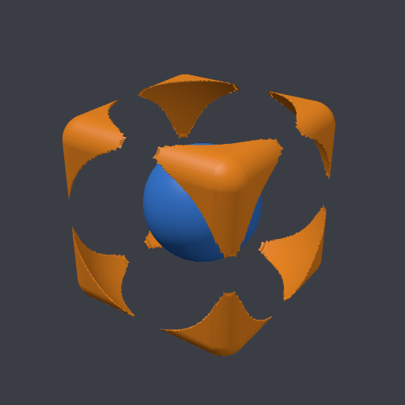
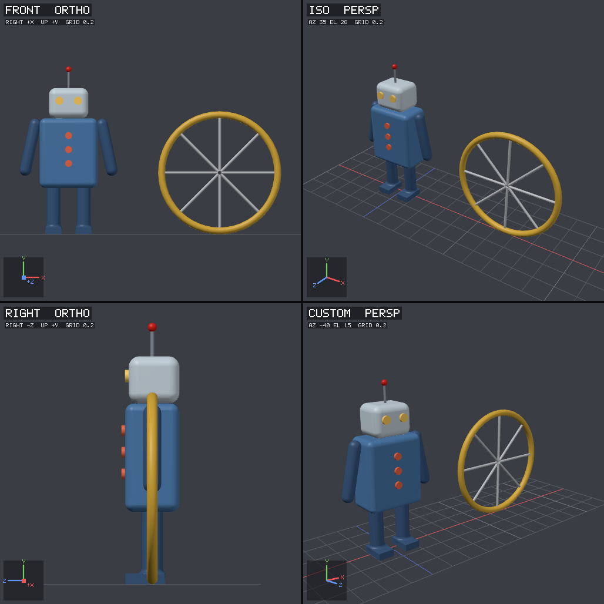

<p align="center">
  
</p>

<h1 align="center">shapeforge</h1>

<p align="center"><b>Let your AI assistant build 3D models.</b><br>
Describe what you want, and Claude, Copilot, Cursor, Codex or any other MCP-capable agent models it, looks at it, fixes it, and hands you an OBJ file.</p>

<p align="center">
  <a href="https://github.com/rashid5925/3d-model-generator/releases/latest">Download</a> ·
  <a href="https://www.npmjs.com/package/shapeforge">npm</a> ·
  <a href="https://rashid5925.github.io/3d-model-generator/">Website</a> ·
  <a href="docs/ARCHITECTURE.md">How it works</a>
</p>



## Why shapeforge?

AI models are great at describing things and not so great at driving tools
made for humans. Ask an agent to use Blender and it ends up writing fragile
scripts against an API it can't see. shapeforge gives the agent a modeling
toolkit designed for how it works:

- **It describes, shapeforge builds.** The agent says *"a cylinder, 3 cm
  radius, 70 cm tall, here"*, not a list of vertices.
- **It can see its work.** Every change can be rendered from the front, side,
  top and in 3D, so the agent notices when a chair leg is floating or a handle
  is on the wrong side.
- **It can measure.** Exact sizes, gaps and "these parts don't touch"
  warnings, because judging dimensions from a picture is hard, even for people.
- **It has placement tools.** "Put the mug on the table", "mirror the left arm",
  "make 8 spokes around the hub" work exactly, without the agent doing 3D math.
- **You get a real file.** OBJ + MTL, with every part named and colored. It
  opens in Blender, Unity, Unreal, a slicer, or anything else.

It's a single small native program. There's no Python, Blender or GPU SDK to
install, and your models never leave your computer.

## Get started

### 1. Connect it to your AI app

The quickest way is to let shapeforge set itself up. You need
[Node.js](https://nodejs.org) for `npx`. Run the command for your agent:

```bash
npx -y shapeforge install claude-code
```

Other agents: `claude-desktop`, `cursor`, `windsurf`, `vscode` (GitHub Copilot),
`copilot-cli`, `opencode`, `codex`, or `all` to set up every agent it finds.
Then restart your agent.

**No Node.js?** Download the file for your system from the
[latest release](https://github.com/rashid5925/3d-model-generator/releases/latest)
and run `shapeforge install <agent>` from it. Or use the installer:

```bash
curl -fsSL https://raw.githubusercontent.com/rashid5925/3d-model-generator/main/scripts/install.sh | sh
```

```powershell
irm https://raw.githubusercontent.com/rashid5925/3d-model-generator/main/scripts/install.ps1 | iex
```

**Claude Desktop?** Download `shapeforge.mcpb` from the
[latest release](https://github.com/rashid5925/3d-model-generator/releases/latest)
and double-click it.

<details>
<summary><b>Prefer to edit config files yourself?</b> Click for each agent's snippet.</summary>

**Claude Code**
```bash
claude mcp add --scope user shapeforge -- npx -y shapeforge
```

**Cursor** (`~/.cursor/mcp.json`), **Windsurf** (`~/.codeium/windsurf/mcp_config.json`), **Claude Desktop**
```json
{ "mcpServers": { "shapeforge": { "command": "npx", "args": ["-y", "shapeforge"] } } }
```

**VS Code with GitHub Copilot**
```bash
code --add-mcp '{"name":"shapeforge","command":"npx","args":["-y","shapeforge"]}'
```

**GitHub Copilot CLI** (`~/.copilot/mcp-config.json`)
```json
{ "mcpServers": { "shapeforge": { "type": "local", "command": "npx", "args": ["-y", "shapeforge"], "tools": ["*"] } } }
```

**OpenCode** (`~/.config/opencode/opencode.json`)
```json
{ "mcp": { "shapeforge": { "type": "local", "command": ["npx", "-y", "shapeforge"], "enabled": true } } }
```

**OpenAI Codex**
```bash
codex mcp add shapeforge -- npx -y shapeforge
```

`shapeforge config` prints all of these with the right paths for your machine.
</details>

### 2. Ask for something

Talk to your agent the way you'd brief a designer:

> Model a wooden dining chair, about 45 cm seat height, with a slightly reclined slatted back. Export it as OBJ.

> Make a coffee mug with a handle and a saucer. Show me front and top views before exporting.

> Build a small desk lamp: round base, two-segment arm, cone shade. Make sure nothing floats.

> Create a 6-spoke wheel, 60 cm across, then a simple bicycle frame around two of them.

Your models are saved in **`Documents/shapeforge`** in your home folder
(`~/shapeforge` on Linux). Each export is an `.obj` with a matching `.mtl` for colors.

## What happens when you ask

A typical session looks like this:

1. **The agent plans the parts**: seat, four legs, backrest, with real dimensions.
2. **It builds them** in one call (`add_objects`).
3. **It looks** (`render`): it gets a picture with front, side, top and 3D views, labeled with axes and a measuring grid.
4. **It measures** (`inspect`): exact sizes, and warnings like *"backrest floats 1.2 mm above the seat"*.
5. **It fixes** with small edits or the placement tools, then looks again.
6. **It exports** (`export_obj`) when it's happy.

You'll see these steps in the conversation. Feel free to steer: *"make the legs
thinner"*, *"show me the back"*, *"undo that"*.

## Tips for better results

- **Give sizes.** "A table, 120 × 70 cm, 75 cm tall" beats "a table".
- **Ask it to check.** "Render it from the side and inspect for gaps" catches most mistakes.
- **Build in steps** for complex things: body first, then details.
- **Save your work.** "Save the scene" keeps an editable copy you can come back to later.
- **Zoom in on small parts.** Ask for a render focused on the handle, for example.

## What the agent can use

| Tool | What it does |
|---|---|
| `add_objects` | Create parts: box, sphere, cylinder, cone, capsule, torus, plane, extruded outline, lathe (vase-like profiles), custom mesh, groups |
| `csg` shapes | Combine shapes: union, subtract (holes), intersect, with smooth blending |
| `update_objects`, `delete_objects`, `undo` | Edit, remove, step back |
| `place_on`, `align_objects`, `mirror_object`, `array_object` | Exact placement: rest on surfaces, line up, mirror left/right, repeat in rows or circles |
| `render` | Pictures from any angle, with labels, highlighting and zoom |
| `inspect` | Sizes, positions, volume, contacts, problems |
| `export_obj`, `save_scene`, `load_scene` | Files out and back in |

## Troubleshooting

- **Check your setup:** `npx -y shapeforge doctor` tests geometry, both renderers, and which agents are configured.
- **Claude Desktop can't find `npx`.** Desktop apps don't always see your
  terminal's PATH. Use the `.mcpb` file, or the downloaded binary with
  `shapeforge install claude-desktop`, which writes a full path.
- **No GPU or Vulkan driver?** That's fine. shapeforge switches to its built-in
  CPU renderer automatically, and the pictures look the same.
- **macOS says the file can't be opened** after a browser download. Run
  `xattr -d com.apple.quarantine shapeforge` once, or install with the
  `curl` command or npm, which avoid this.

## Build from source

You need CMake 3.20+ and a C++20 compiler. Nothing else.

```bash
cmake -S . -B build && cmake --build build -j
```

```bash
ctest --test-dir build --output-on-failure
```

```bash
./build/shapeforge render examples/table_set.json -o table.png
```

See [docs/ARCHITECTURE.md](docs/ARCHITECTURE.md) for how the code is organized
and [docs/RELEASING.md](docs/RELEASING.md) for how releases are built.

## License

[MIT](LICENSE)
