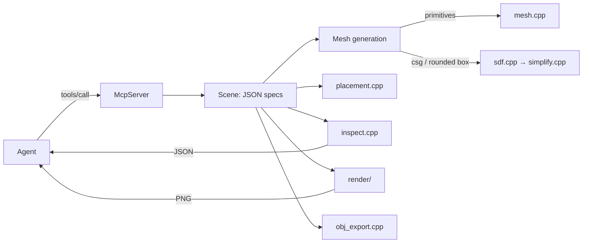

# Architecture

shapeforge is a single C++20 executable. Its main mode is an MCP server
(JSON-RPC 2.0 over stdio) that keeps a scene of named parts. Parts are stored
as JSON specs and turned into triangle meshes on demand. The server renders
images for visual feedback, reports measurements, and exports OBJ.

## Components

| Path | Responsibility |
|---|---|
| `src/main.cpp` | CLI: `mcp`, `install`/`uninstall`, `config`, `doctor`, `render`, `export`, `inspect`, `shapes` |
| `src/mcp_server.*` | JSON-RPC loop, tool schemas and descriptions, tool handlers, atomic batches, undo |
| `src/json.*` | Order-preserving JSON parser/serializer |
| `src/scene.*` | Spec validation (with typo suggestions), hierarchy resolution, mesh cache keyed by geometry |
| `src/mesh.*` | Primitive generators (box, lathe-based shapes, torus, extrusion via ear clipping, raw meshes), transforms, volume/area |
| `src/sdf.*` | Signed-distance primitives and CSG operators; surface-nets polygonizer with automatic resolution |
| `src/simplify.*` | Quadric edge-collapse simplification and crease-angle normals for SDF output |
| `src/placement.*` | `place_on` (bounding-box placement refined by a mesh sweep), align, mirror, linear/radial arrays |
| `src/inspect.*` | Bounds, volumes, contacts, per-axis gaps, floating/below-ground warnings |
| `src/render/` | View/camera setup and overlays (`render.cpp`), Vulkan backend, CPU backend, runtime Vulkan loader |
| `src/image.*` | Image ops, bitmap font, PNG encoder (built-in DEFLATE), base64 |
| `src/obj_export.*` | OBJ + MTL writer (one object and material per part) |
| `src/platform.*` | Paths, stdio setup, MCP client registration for eight agents |

## Key design decisions

- **Specs are the source of truth.** The scene is an ordered list of JSON
  objects; meshes are derived and cached by a key that excludes placement
  fields. Save/load, undo and edits are therefore simple, and moving a part
  never rebuilds its mesh.
- **Atomic tool calls.** Every mutating tool works on a copy of the scene and
  commits only if every item succeeds.
- **Two geometry paths.** Primitives are generated analytically: exact and
  low-poly. Booleans use signed distance fields, polygonized with surface nets
  (quad winding derived from grid topology), then simplified with quadric error
  metrics and given crease-aware normals.
- **Renderer independence.** `Renderer` has a Vulkan implementation (headless:
  offscreen MSAA target, resolve, readback) and a multi-threaded software
  rasterizer that share one shading model. Vulkan is loaded at runtime
  (`vk_loader.cpp`), or MoltenVK is linked statically on macOS, so the binary
  starts on machines without any Vulkan installation.
- **Feedback for the model.** Renders tile orthographic and perspective views
  with axis labels, grid spacing and an orientation gizmo. `inspect` provides
  the numeric side, since visual feedback alone doesn't fix dimensional errors.
- **No third-party dependencies.** JSON, PNG/DEFLATE and the MCP transport are
  in-tree. SPIR-V shaders are committed, so building needs only CMake and a
  compiler.

## Conventions

- Right-handed, +Y up, the model's front faces +Z, units in meters.
- Euler rotations are in degrees, applied X, then Y, then Z.
- Triangles wind counter-clockwise seen from outside. Mirroring transforms flip
  the winding automatically.

## Tests

- `tests/unit_tests.cpp`: JSON, primitives (volume checks), CSG orientation, simplification, validation, hierarchy, placement, mirror/array, CPU rendering.
- `tests/mcp_smoke_test.py`: drives the real executable over the MCP protocol end to end, including OBJ validation.
